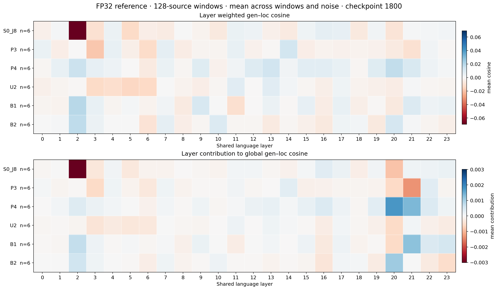
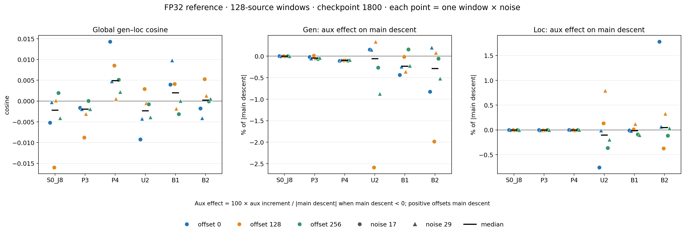
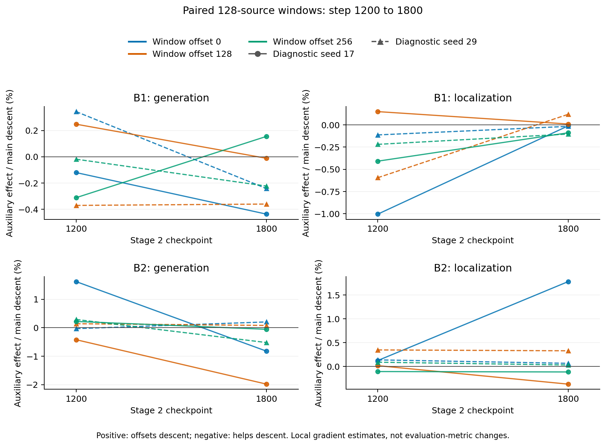

# 三地图消融的联合训练梯度诊断

## 任务与执行状态（2026-11-02）

本任务实现离线梯度诊断，并对已同步 checkpoint 实测。只读取训练权重与 `seen_train` 数据，不执行 optimizer step，不更新训练权重，也不以 test 数据选择诊断设置。已有实验配置与训练方法保持原样。

完成状态：实现、正确性验收、六组筛查、六组确认、首轮三组时间对照，以及B1／B2的1200步窗口补测全部完成。覆盖7种实验配方、9个checkpoint，共31份正式报告／62次诊断观测；严格导出核对无缺失、无无效报告。B1、B2在1200与1800步现均为3个窗口×2组诊断采样，可逐一配对。这里的观测次数不是独立训练重复次数。

已完成小 batch 数值验收，正式批量诊断采用 **FP32 确定性参考**。BF16 默认／确定性参考的误差均原样保留，没有放宽线性阈值来使检查通过。

完成范围：screen为6份报告／12次观测，confirm为18份／36次，首轮temporal为3份／6次，temporal_extended新增4份／8次。screen全窗口独立梯度重建最大相对残差为1.27144e-5；confirm／temporal及补测采用经真实B2对照验收的分项合成，并保留首微批独立检查。源样本池按 `(map, file_frame, row_id)` 稳定标识构建，避免不同实验的数据集内部顺序导致错配。逐层统计／分项合成路径通过38项CPU测试；本轮offload入口和补测控制器另通过7＋8项CPU测试及真实GPU小batch验收。正式队列共2496次aux-loc微批冻结检查全部通过（原1984＋新增512）；关闭该辅助的观测明确记为不适用。

## 已确认的核心结论

1. **不能将当前瓶颈归结为持续的全局主任务冲突。** 六组local1800的36次确认中，整体生成／定位余弦为−0.01596～0.01429，合成负梯度对两主损失均是一阶下降。但局部干扰确实存在：S0某次layer2抵消生成自梯度下降96.5%，因此“没有方向反转”不等于“没有干扰”。
2. **P与U的量级和作用方式不同。** P3／P4的辅助／主范数中位数约0.44%／0.30%；U2、B1、B2约17.63%／19.25%／13.81%。P4对生成的辅助方向六次均有利，但不能据此声称其验证优势的机制已被证明。U并非普遍过弱，其方向需分窗口和任务考察。
3. **both没有表现为持续的P／U相互抵消。** B1、B2确认中P–U各五次同向、一次反向，两辅助自身的总方向均下降。筛查出现过P下降被削弱63.66%的个例，确认未形成持续模式；B2定位侧仍有最高1.78%的主下降抵消，不能概括为所有方向均有益。
4. **未发现aux-loc临时冻结导致定位私有头梯度泄漏。** 正式窗口与小batch检查共同支持现有冻结路由；辅助头eval与checkpoint门控的源码核对也一致。BF16诊断存在数值分辨限制，正式结论来自通过重建验收的FP32参考，不能据此断言原训练应改为FP32。
5. **后续先拆解aux-loc共享梯度的两条路径。** 当前共享梯度可能同时经过生成图像路径和定位评估分支的直接参数路径，尚未分别测量；优先做有限的路径诊断，再决定是否约束某个分支。暂不优先重复已完成的权重网格或直接启用全模型PCGrad。
6. **三窗口补测修正了单窗口的时间趋势。** B1生成侧4／6组相对改善、定位侧5／6组变差；B2两侧各5／6组改善，但仍有定位抵消增加至1.78%的个例。两组均未表现为主任务余弦统一改善或恶化。B1@1200新增一个P目标微弱局部上升个例，U在其中提供帮助，不能归因为P／U相互抵消。完整配对与判断见文末补测章节。

## 诊断范围与阶段

| 阶段 | 对象 | 核查内容 | 完成条件 |
|---|---|---|---|
| 0：正确性 | 小 batch，优先 B2／U2 | loss 分解、加权梯度线性、共享与私有参数路由、aux-loc 临时冻结、checkpointing 开关 | 明确实际行为与数值误差；若有问题，区分诊断修复与训练方法修改 |
| 1：筛查 | S0_J8、P3、P4、U2、B1、B2 的 local1800 | 固定三图训练样本，生成／定位主梯度与辅助贡献 | 固定参数坐标、样本与噪声记录；所有实验有独立结果 |
| 2：确认 | 阶段 1 的全部六组 | 梯度先按 source effective batch128 聚合，再计算范数／余弦；三个窗口×两个噪声种子 | 区分小 batch 波动与累积后方向；记录实际 microbatch 与 GAS |
| 3：时间对照 | B1／B2 local1200、J8 step5850 | both 后期变化与 Stage1→Stage2 变化 | 所用 checkpoint 已同步且严格加载；不推断没有实测的时间段 |
| 3补：时间对照扩窗 | B1／B2 local1200的offset128／256 | 补齐与1800相同的三窗口×两采样；每组6个时间配对 | 原样本／坐标／微批／权重配对，新增4报告全部验收通过；J8范围不变 |

实际固定池为每图 128 条 source 样本（共 384）；筛查使用每图 32 条的子集（共 96）。累积窗口与微批次设置经小 batch 显存、耗时和正确性检查确定。两组固定噪声种子用于检查结论是否只来自一次采样，不用于重新训练或选择评测 seed。这里的`noise_seed`同时设置Python／NumPy／Torch随机状态，保留train模式：变化可能包含flow噪声、LoRA dropout和数据集的CFG prompt dropout（默认0.1）；没有把这些随机源单独隔离。因此两次观测的差别统称诊断采样变化，不能全归因于某一种噪声。

## 统计口径

`raw` 梯度保留模型当前的 task mask、维度均值、timestep 权重、candidate 聚合，只移除最外层 loss 系数。当前目标为 `Lgen + 8 Lloc + wP Lperception + wU Laux_loc`，加载时逐项核对其余损失关闭。Stage2 local1800 的辅助系数必须由调度恢复，不能照抄 YAML 起始值 0。关闭的辅助项沿用forward中的零损失，不额外开启计算；其raw零梯度不是“若开启该辅助”的反事实测量，相关余弦标为未定义。

共享坐标固定为实际可训练的 language_model 参数；正式96／128源样本窗口均只测该共享坐标。私有生成头、定位头和连接器仅在小 batch 正确性阶段单独核查，不能将其视为全窗口私有头诊断。冻结的 vision tower／multi_modal_projector 不并入共享参数。缺失梯度在代数中按零处理，同时记录 None／零／非零／非有限覆盖率；零范数时余弦未定义。

令 `g_i = ∇shared L_i`、`h_i = w_i g_i`、`gB = hg + hl`、`hA = hP + hU`、`gT = gB + hA`：记录原始／加权 L2 范数、两两余弦、`||hA||/||gB||` 及各辅助比例、带符号投影 `h_i·gT / ||gT||²`、主损失的一阶方向量 `−g_i·gT` 与辅助增量 `−g_i·hA`。带符号投影可为负或大于 1；范数比例不构成相加为 100% 的分配。

先在相同参数坐标上累积梯度，再计算指标。统计 FP32、未裁剪梯度；不把微批次余弦平均当作有效 batch 余弦。梯度几何仅表示当前 checkpoint 和采样窗口的局部性质，不等同于 AdamW 的真实更新方向，也不能单独证明验证集退化的因果。

还量化两个主任务彼此的局部作用：以加权梯度G、L表示，定位项对生成自梯度下降的抵消率为`−100(G·L)/||G||²`，生成项对定位则为`−100(G·L)/||L||²`，正值抵消、负值帮助，零分母不定义。整体余弦接近0时，范数比例仍可能放大某一方向的影响；因此不只按余弦大小判断。该去项比较固定当前checkpoint，不等同于独立单任务续训实验。

另外报告辅助对主方向的相对一阶影响：`d_main = d_total - d_aux`；仅当 `d_main < 0` 时定义 `100*d_aux/|d_main|`。正值表示抵消部分主方向下降，负值表示帮助下降；它与辅助／主梯度范数比例不是同一个量。full 模式的差分含已测的极小重建残差，因此该比例作为局部近似使用。

对both另检查辅助目标自身：记`G,L,P,U`为四项加权梯度，令`A`为P或U、`B`为另一辅助，记录`b=A·(G+L+A)`、`c=A·B`、`A·total=b+c`。仅当`b>0`时定义另一辅助的抵消率`−100c/b`，正值削弱A的一阶下降，负值帮助；超过100%且total点积为负时才表示方向翻转。这里是同checkpoint、同采样的局部代数去项，不是重新训练后的counterfactual，也不是主指标变化百分比。`b`接近0时比例会被放大，因此必须同时看绝对点积和方向，不能仅按抵消百分比排序严重程度。full模式另保留直接total向量的点积及重建残差；component_sum两者均属分项代数统计，不作为独立验收。

筛查采用 `full`：每个微批直接测量四项分量及 main／total VJP。完成六组独立重建验收后，确认与时间对照采用 `component_sum`：四项梯度仍在每个微批直接测量，main／total由平均加权分项构造；首微批另做 direct main／total重建、重复VJP和普通backward检查。全窗口独立 direct-linearity、actual auxiliary increment及其残差在该模式中明确为 `null／未测`，不能用构造恒等式冒充独立通过。其余目标的外层权重必须逐批为零。

## 资源与复现

初始检查：本机一张 RTX PRO 6000 Blackwell 96 GB，其他程序占用约 59 GB。诊断将串行加载模型，先用小 microbatch 测试，通过梯度累积保留指定 source batch 口径；不终止其他程序。记录每次运行的设备、实际参数、checkpoint、样本、噪声、时长与峰值显存。

### 实际运行成本

首轮正式队列首尾墙钟约292.6分钟；27个报告各自耗时之和约288.6分钟，报告间隙约4.0分钟。该范围不含更早的小batch正确性开发／试跑，也不含文末另列的4报告补测成本。下表每行是该组在对应阶段的全部窗口和两个种子的总耗时，不能当作单次测量耗时。

| 阶段 | 实验 | 报告／观测 | microbatch×累积 | 报告墙钟分钟 | 报告measure分钟 | 测量显存峰值GiB |
|---|---|---:|---:|---:|---:|---:|
| screen | S0_J8 | 1／2 | 8×12 | 4.32 | 3.55 | 12.24 |
| screen | P3 | 1／2 | 2×48 | 9.94 | 8.69 | 21.64 |
| screen | P4 | 1／2 | 2×48 | 10.28 | 8.88 | 21.64 |
| screen | U2 | 1／2 | 1×96 | 23.45 | 22.25 | 21.03 |
| screen | B1 | 1／2 | 1×96 | 28.38 | 27.21 | 26.30 |
| screen | B2 | 1／2 | 1×96 | 27.07 | 26.08 | 26.30 |
| confirm | S0_J8 | 3／6 | 8×16 | 10.57 | 8.35 | 12.31 |
| confirm | P3 | 3／6 | 2×64 | 25.49 | 23.34 | 21.66 |
| confirm | P4 | 3／6 | 2×64 | 18.26 | 16.42 | 21.66 |
| confirm | U2 | 3／6 | 2×64 | 29.00 | 26.88 | 33.93 |
| confirm | B1 | 3／6 | 2×64 | 36.98 | 34.71 | 44.69 |
| confirm | B2 | 3／6 | 2×64 | 36.15 | 33.93 | 44.69 |
| temporal | B1 | 1／2 | 2×64 | 13.11 | 11.84 | 44.69 |
| temporal | B2 | 1／2 | 2×64 | 12.60 | 11.30 | 44.69 |
| temporal | J8 | 1／2 | 8×16 | 2.97 | 2.27 | 12.31 |

报告墙钟含模型构建／加载等时间；measure为报告中`elapsed_seconds`之和，包含梯度测量及该轮统计开销。显存是measure阶段的`max_memory_allocated`，不代表加载过程、整个进程或其他程序的显存峰值。运行时与其他程序共享GPU，空闲资源发生变化，故该表用于复现预算，不作为P／U／B算法速度的公平比较。首选microbatch随空闲显存调整，确认和时间对照的source effective batch始终为128。全部正式任务均未触发OOM重试。详见[实际执行汇总](docs/gradient_diagnostics_20261102/final_execution_summary.json)。

## 方法参考与采用条件

- [GradNorm，ICML 2018](https://proceedings.mlr.press/v80/chen18a.html)：尺度和相对训练速度失衡时考虑动态调权；不是仅令原始梯度范数相等。
- [PCGrad，NeurIPS 2020](https://arxiv.org/abs/2001.06782)：任务梯度存在负内积时投影去除冲突分量。需先确认聚合后冲突以及与验证表现的对应关系；不能由单个负余弦直接认定长期负迁移。
- [CAGrad，NeurIPS 2021](https://proceedings.neurips.cc/paper/2021/hash/9d27fdf2477ffbff837d73ef7ae23db9-Abstract.html)：在平均目标方向附近兼顾最差任务的局部改善；若加权更新反复伤害某个主任务，可作为比逐对投影更整体的方向协调对照。论文的优化保证不能直接套用到本项目 AdamW、噪声梯度与任意辅助目标上。
- [MGDA，NeurIPS 2018](https://papers.nips.cc/paper/2018/hash/432aca3a1e345e339f35a30c8f65edce-Abstract.html)：以多目标优化寻找共同下降的梯度组合，适合愿意重新确定任务折衷的设置。其目标不等于保持当前固定权重，故不作为本轮默认训练修改。
- [PyTorch checkpoint 文档](https://docs.pytorch.org/docs/main/utils/checkpoint.html)：non-reentrant checkpoint 支持 `autograd.grad`；正向和重计算状态必须一致，因此临时冻结与训练模式需要实测。

## 实测结果与逐实验分析

下文分别呈现筛查、已完成确认与时间对照证据。原始诊断文件与失败记录一并保留，以区分实际观测和推断。

### 96 源样本筛查（已完成）

每个范围为 noise17／29 的最小—最大值；所有数据均为共享坐标、先累积后统计。

| 实验 | cos(gen, loc) | 加权loc／gen范数比 | 辅助／主梯度合量 | cos(perception, gen) | 检查 |
|---|---:|---:|---:|---:|---|
| S0_J8 | −0.00402～0.00478 | 1.434～3.228 | 0 | 不适用 | 线性／重复VJP／普通backward通过 |
| P3 | −0.00324～0.00077 | 1.530～2.153 | 0.402%～0.492% | −0.01060～0.07603 | 同上 |
| P4 | −0.00504～−0.00214 | 1.750～2.538 | 0.268%～0.414% | 0.12798～0.14723 | 同上 |
| U2 | −0.00200～0.00178 | 0.350～1.103 | 7.505%～32.210% | 不适用 | 同上；192次冻结检查通过 |
| B1 | 0.00023～0.00327 | 0.648～3.782 | 1.582%～16.288% | 0.04156～0.11063 | 同上；192次冻结检查通过 |
| B2 | 0.00298～0.00377 | 0.417～0.780 | 13.349%～14.008% | 0.02151～0.18317 | 同上；192次冻结检查通过 |

S0_J8、P3、P4 的合并方向均使两个主目标在共享坐标上的一阶变化为负。共享坐标整体的 gen／loc 接近正交，尚无证据表明主任务存在强而稳定的整体冲突。P4 的辅助与生成方向在这两次采样中同向，P3 则有符号变化；P系列辅助贡献均较小。P3／P4的训练对照仍然成立，但当前梯度差异同时包含已学权重和loss定义的影响，不能仅凭快照建立“attention改变梯度方向，进而导致指标变化”的机制因果链。确认阶段已增加逐层统计，检查整体统计可能掩盖的局部关系，结果见下文。

U2 的辅助范数明显高于 P 系列且随噪声采样变化较大，不能把全部辅助损失统称为弱信号。其 `cos(aux_loc, gen)` 为−0.00233／−0.00372，`cos(aux_loc, loc)` 为0.00953／−0.01649；生成主损失的辅助一阶增量两次为正但很小，定位辅助增量有正有负。两主损失的总方向仍均下降；192次辅助冻结检查、两次重复VJP和普通backward对照全部通过。此时支持进一步检查辅助方向／波动，不支持将主任务总体冲突视为已证实根因。

B1 的 `cos(perception, aux_loc)` 为0.01156／0.00023，未见明显直接抵消；aux-loc 加权范数分别约为 perception 的23.4倍／8.9倍。两次辅助合量均与生成主梯度同向，对定位的辅助增量则有符号变化；两个主目标的总方向仍均下降。与此同时，加权定位梯度范数为0.0640／0.4473，说明同一checkpoint下的诊断随机采样也会影响平均梯度量级，不能用一次范数比直接决定调权。这不是将跨实验差异归因于训练 seed 或服务器差异。B1 验证 FID 较差的原因尚不能由这些局部梯度统计确定。

B2 的 `cos(perception, aux_loc)` 为0.02250／−0.10462，因此不能将B1的“未见直接抵消”泛化到所有both配方。P与生成主梯度的余弦为0.18317／0.02151，U与生成的余弦为−0.00671／0.06259；辅助合量两次均与生成同向，对定位的增量则有符号变化。seed17中，P对生成的点积约+1.47e-5，足以抵消U约−8.40e-6的点积，虽然U范数约为P的15.6倍。范数比例不能代替方向贡献；这仍是单checkpoint的局部观测，不能证明某个attention设置稳定更优。

B2 screen seed29也说明另一种容易误判的情况：`||P+U||/||U||≈0.996`，但`P·(G+L+P)=2.53991e-6`、`P·U=−1.61697e-6`；U抵消了P目标原本约63.66%的一阶下降幅度，P与total点积仍为正。这只是该次筛查的辅助目标局部统计，没有在已完成confirm中形成持续模式，也不表示生成／定位主目标上升。CPU渲染增强的9项fixture覆盖了符号、翻转、无辅助、分母非正、缺字段和本例复核，未新增GPU计算。

### 128 源样本窗口确认（已完成）

每组的六次观测是同一checkpoint下的3个窗口×2组诊断采样，不是6次独立训练重复；源帧不重复也不意味着数据在统计上独立。下述中位数／范围仅作描述性统计。“总方向未使主损失一阶上升”不排除交叉项减少下降幅度：自梯度项可能使总方向仍下降；也不代表真实AdamW更新或验证指标改善。

S0_J8 的三个窗口×两噪声种子已完成，覆盖384条不重复源样本。共享整体 `cos(gen, loc)` 中位数−0.00217，范围−0.01596～0.00196；六次合并方向均使两主目标一阶下降。24层×6次观测中，也没有出现gen／loc与该层总梯度负点积。局部负相关存在：例如layer2的余弦范围−0.23694～0.03747，符号随窗口／噪声变化，不能由最负一次直接认定持续受损。

P3 的三个窗口×两噪声种子也已完成。`cos(gen, loc)`中位数−0.00194，范围−0.00876～0.00005；perception／主梯度范数比为0.344%～0.558%，中位数0.442%。`cos(P, gen)`中位数0.0530，范围−0.0139～0.0795，六次中五次同向。辅助对生成主方向的相对一阶影响为−0.0671%～+0.0139%，对定位为−0.00821%～+0.00060%；两个主目标的整体和逐层合成方向仍全部下降。P3共享辅助贡献较小；本次观测中，其辅助项对生成主方向最多抵消0.0139%，对定位最多抵消0.00060%，合成方向均保持一阶下降。这不证明其对长期训练／验证指标无作用，也不直接支持增大权重。

P4 六次观测的`cos(gen, loc)`均为正，中位数0.00494，范围0.00055～0.01429；`cos(P, gen)`为0.10156～0.15903，中位数0.13971，在本次三个窗口×两个诊断采样中较P3方向更一致。perception／主范数比例为0.170%～0.494%，对生成主方向的相对影响全部帮助下降（−0.1123%～−0.0808%），对定位则为−0.00394%～+0.00202%。整体及24层合成方向均没有主损失一阶上升。其辅助范数较小并未阻止方向更一致；这支持保留P4为单辅助参照，但不足以说明attention关闭通过这一机制导致验证指标变化。

U2 六次确认的`cos(gen, loc)`中位数−0.00232，范围−0.00924～0.00290；aux-loc／主范数比中位数17.63%，范围5.62%～30.39%，高于P系列0.170%～0.558%的本次观测范围。`cos(U, gen)`为−0.01201～0.07167，`cos(U, loc)`为−0.02324～0.02182；对生成的相对一阶影响为−2.5845%～+0.3380%（三次帮助、三次抵消），对定位为−0.7554%～+0.7922%（四次帮助、两次抵消）。这些方向变化没有使整体或任何一层的主损失总方向转为上升，384次微批冻结检查均通过。U2不能被概括为辅助梯度过弱或持续损伤生成；更值得解释的是信号通过哪条路径起作用，而非只按一次范数比继续改权重。

B1 六次确认的`cos(gen, loc)`为−0.00316～0.00978，中位数0.00198；辅助／主范数比为6.78%～30.87%，中位数19.25%。P与生成主梯度六次均同向（0.02790～0.09417）；辅助合量对生成五次帮助、一次抵消，影响为−0.4371%～+0.1554%；对定位四次帮助、两次抵消，影响为−0.1025%～+0.1193%。整体和逐层主目标总方向仍均下降。

B1的`cos(P,U)`为−0.01286～0.02188，五次为正、一次为负。U对P自身下降的相对影响为−23.67%～+7.62%，没有出现P目标或U目标的总方向上升。因此本组共享坐标不支持“两个辅助持续相互抵消”这一概括，也不能把P小范数直接解释为P失效。B1的验证FID／Pitch等弱项仍然存在，说明局部梯度同向本身不足以说明评测收益；私有头、长期优化轨迹和具体辅助路径没有被这项共享统计充分覆盖。

B2 六次确认的`cos(gen, loc)`中位数0.00024，范围−0.00412～0.00527；辅助／主范数比为5.79%～38.02%，中位数13.81%。辅助合量对生成四次帮助、两次抵消，影响−1.9810%～+0.2039%；对定位两次帮助、四次抵消，影响−0.3718%～+1.7807%。总方向在整体和24层上均未使主损失一阶上升，但该定位侧抵消个例需要保留，不能称作所有方向均获益。

B2的P／U余弦五正一负，范围−0.00550～0.05945。五次`b=P·(G+L+P)>0`的观测中，U的抵消率最高为+1.15%，其他为帮助；另一次offset128／seed17中，`P·(G+L+P)=−3.30378e-7`本来对应P目标上升，而`P·U=+1.06876e-6`将总点积转为正，此时按定义不计算抵消百分比。两项辅助的总方向六次均各自下降。故screen单次63.66%的P下降抵消没有在confirm中体现为持续模式；不宜用它单独支持both辅助冲突的结论。

### 确认阶段汇总表

每行均为同一local1800的3窗口×2诊断采样；数值为中位数 [最小值, 最大值]。主任务抵消率及辅助影响的正值表示减少该任务的局部下降幅度，负值表示帮助。主任务抵消率以该任务自梯度下降为分母，辅助影响以G+L主方向下降为分母，两列不能直接相加。

| 实验 | cos(G,L) | 定位主项对生成抵消率% | 生成主项对定位抵消率% | 辅助／主范数% | 辅助对生成影响% | 辅助对定位影响% |
|---|---:|---:|---:|---:|---:|---:|
| S0_J8 | -0.0022 [-0.0160, 0.0020] | 0.1774 [-0.6576, 7.0595] | 0.1508 [-0.0585, 0.5664] | 0.0000 [0.0000, 0.0000] | 0.0000 [0.0000, 0.0000] | 0.0000 [0.0000, 0.0000] |
| P3 | -0.0019 [-0.0088, 0.0000] | 0.3436 [-0.0076, 1.2796] | 0.1267 [-0.0032, 0.5996] | 0.4418 [0.3437, 0.5580] | -0.0396 [-0.0671, 0.0139] | -0.0008 [-0.0082, 0.0006] |
| P4 | 0.0049 [0.0005, 0.0143] | -0.9733 [-6.2489, -0.0699] | -0.2631 [-0.4220, -0.0428] | 0.2999 [0.1701, 0.4942] | -0.0951 [-0.1123, -0.0808] | -0.0010 [-0.0039, 0.0020] |
| U2 | -0.0023 [-0.0092, 0.0029] | 0.1600 [-0.1854, 0.8655] | 0.1512 [-0.4529, 3.2973] | 17.6333 [5.6209, 30.3934] | -0.0550 [-2.5845, 0.3380] | -0.1020 [-0.7554, 0.7922] |
| B1 | 0.0020 [-0.0032, 0.0098] | -0.1813 [-1.4000, 0.4428] | -0.2010 [-0.6835, 0.2255] | 19.2502 [6.7763, 30.8691] | -0.2328 [-0.4371, 0.1554] | -0.0135 [-0.1025, 0.1193] |
| B2 | 0.0002 [-0.0041, 0.0053] | -0.0512 [-0.3696, 1.1460] | -0.0115 [-0.7502, 0.4941] | 13.8147 [5.7880, 38.0239] | -0.2873 [-1.9810, 0.2039] | 0.0476 [-0.3718, 1.7807] |

### 共享梯度范数

以下为六次观测的中位数，G、L、P、U依次为gen、loc、perception、aux-loc。关闭的辅助显示为“—”，不代表测过开启该辅助的反事实。

| 实验 | raw gen | raw loc | weighted loc (×8) | raw P | weighted P (×0.05) | raw U = weighted U (×1) |
|---|---:|---:|---:|---:|---:|---:|
| S0_J8 | 0.101238 | 0.035603 | 0.284822 | — | — | — |
| P3 | 0.089723 | 0.016056 | 0.128448 | 0.014301 | 0.000715 | — |
| P4 | 0.094655 | 0.025237 | 0.201900 | 0.013740 | 0.000687 | — |
| U2 | 0.087169 | 0.011758 | 0.094066 | — | — | 0.020509 |
| B1 | 0.088985 | 0.014132 | 0.113059 | 0.016477 | 0.000824 | 0.025265 |
| B2 | 0.084358 | 0.019106 | 0.152847 | 0.012669 | 0.000633 | 0.022551 |


### 逐层结果与图表

36次确认×24层均没有主任务total方向上升；仅使用G+L的逐层方向也未上升。然而负交叉项可以明显削弱下降：S0 offset128／seed17的layer2，定位项抵消该层生成自梯度下降96.5145%，这项负点积占全共享生成自梯度下降的4.8243%；该窗口整体抵消7.0595%。S0 layer2的余弦四次为负、两次为正，尚不能视为持续瓶颈。

| 实验 | 最大单层生成抵消% | 对应层／offset／seed | 该项对整体生成自梯度的抵消% | 最大单层定位抵消% |
|---|---:|---|---:|---:|
| S0_J8 | 96.515 | 2／128／17 | 4.824 | 16.841 |
| P3 | 11.603 | 2／256／29 | 0.326 | 3.489 |
| P4 | 17.221 | 2／256／17 | 0.699 | 3.028 |
| U2 | 11.596 | 5／256／29 | 0.255 | 16.699 |
| B1 | 10.721 | 2／256／17 | 0.326 | 4.918 |
| B2 | 13.661 | 2／0／29 | 0.526 | 5.653 |

这些是逐层最大观测，不是平均值；最后一列的最大值可能出现在另一层／窗口。不同实验的终点参数与内部采样轨迹不同，不能把表中差异直接解释为辅助消除了S0的局部冲突。后续若研究主任务协调，应先复核这个局部现象的持续性，而非仅凭整体余弦决定。



上图为六次观测均值；下半图每层贡献使用整体G、L范数归一化，逐层贡献之和与整体余弦均值一致。均值不能表示所有窗口的符号相同。



每个点是一组窗口×诊断采样，颜色区分窗口、形状区分采样；不代表独立训练重复。PNG、可编辑SVG及绘图数据JSON保存在同一目录。

### 首轮时间对照（offset0；历史记录）

本小节保留首轮单窗口结果。B1／B2补齐三个窗口后的判断以文末“2026-11-02：B1／B2的1200步时间对照补测”为准；不能将本节的两次观测表述扩大为全部窗口。J8→S0_J8本次没有新增窗口。

B1／B2分别比较local1200与local1800；J8@5850与S0_J8@local1800比较无辅助续训前后。每一对使用相同offset0的128条源样本及顺序、采样种子17／29、参数坐标和外层loss权重。B组均为microbatch2×64，J8／S0为8×16。运行结束后的Python／NumPy／CPU／CUDA RNG状态哈希也逐对相同，但这不是所有内部随机张量逐元素相同的独立证明。该对照只覆盖一个窗口，不与local1800三个窗口的中位数混作同一口径。

以下正值为辅助抵消主方向下降，负值为帮助；P／U余弦针对两项辅助。

| 对照 | step | seed | cos(G,L) | 辅助／主% | 辅助对生成% | 辅助对定位% | cos(P,U) |
|---|---:|---:|---:|---:|---:|---:|---:|
| B1 | 1200 | 17 | 0.00840 | 37.957 | -0.120 | -1.004 | 0.01532 |
| B1 | 1800 | 17 | 0.00394 | 28.364 | -0.437 | -0.011 | 0.00296 |
| B1 | 1200 | 29 | 0.00917 | 8.708 | 0.344 | -0.113 | 0.03358 |
| B1 | 1800 | 29 | 0.00978 | 6.776 | -0.242 | -0.016 | -0.01286 |
| B2 | 1200 | 17 | -0.00148 | 33.362 | 1.621 | 0.123 | -0.08813 |
| B2 | 1800 | 17 | -0.00178 | 29.473 | -0.824 | 1.781 | 0.05517 |
| B2 | 1200 | 29 | -0.00488 | 6.557 | -0.032 | 0.137 | 0.05126 |
| B2 | 1800 | 29 | -0.00412 | 5.788 | 0.204 | 0.065 | 0.05945 |

**B1：生成侧改善，定位侧帮助减弱。** 两组采样的辅助／主范数比均下降，但应优先看带符号作用：生成侧一次帮助增强，另一次由抵消转为帮助；定位侧仍有帮助，幅度则从−1.004%／−0.113%减弱至−0.011%／−0.016%。P–U关系并非全部改善，seed29由正转负，对P自身下降的作用从帮助10.54%转为抵消7.62%。没有观测到两个主方向共同出现辅助冲突加剧；同期验证Pitch和FID变差，当前共享快照不足以解释或归因这些变化。

**B2：变化随任务和采样不同。** seed17生成侧由抵消转为帮助，定位抵消增强；seed29生成侧由轻微帮助转为抵消，定位抵消减弱。P–U在seed17由负转正，对P自身下降从抵消11.60%转为帮助11.88%；seed29始终同向。同期九项已列验证指标均改善。这些快照不支持以单一的“冲突统一加重”或“冲突统一减弱”解释全部评测变化，也不能把P–U改善单独当作指标改善的机制证明。

在本节offset0的观测范围内，B1／B2两个时间点的整体主任务、两辅助目标总方向均保持一阶下降；24层的主任务total方向与仅G+L方向也均未上升。上述抵消与帮助的变化仍须保留，不能被“没有上升”抹平。

**J8→S0_J8：无辅助续训本身就改变局部关系。** 两组诊断采样的生成／定位raw loss都下降，但生成主项受到的定位抵消一组从0.1959%增至0.9378%，另一组从0.6232%减至0.0601%；定位侧抵消也一增一减。整体和24层主任务合成方向均下降。已有验证结果8／9项改善而FID变差，说明不能把FID后期退化一概归因于辅助。该快照对照包含续训后的权重变化，不能分离学习率、优化轨迹等因素。

| checkpoint | seed | raw gen loss | raw loc loss | 加权G范数 | 加权L范数 | 定位主项对生成抵消% |
|---|---:|---:|---:|---:|---:|---:|
| J8@5850 | 17 | 0.735356 | 0.001843 | 0.086582 | 0.189191 | 0.1959 |
| S0_J8@1800 | 17 | 0.732711 | 0.001649 | 0.100865 | 0.181059 | 0.9378 |
| J8@5850 | 29 | 0.719104 | 0.001306 | 0.095147 | 0.179880 | 0.6232 |
| S0_J8@1800 | 29 | 0.716103 | 0.000986 | 0.106253 | 0.253584 | 0.0601 |

这里的训练样本loss不等同于验证误差，也不要求梯度范数随loss单调下降。S0的96.5%局部抵消发生在offset128，本轮J8时间对照是offset0，因此没有追踪该特定个例的形成过程。完整逐对数值、源样本匹配和RNG核对见[时间对照证据](docs/gradient_diagnostics_20261102/temporal_comparison.json)。

### 实验配方与验证集背景

下列 Stage2 均从 J8@5850 续训，定位主损失系数为 8，辅助 ramp 在 local120 完成。辅助权重为诊断 checkpoint 实际值，不是 YAML 中的 ramp 起始值。

| 实验 | 完整实验目录名 | checkpoint | perception | aux-loc | perception attention | 对照作用 |
|---|---|---:|---:|---:|---|---|
| J8 | `exp32_3maps_joint_constloc8` | 5850 | 0 | 0 | 不适用 | Stage1 主任务结构 |
| S0_J8 | `exp32_3maps_stage2_control_j8` | local1800 | 0 | 0 | 不适用 | 同训练长度联合无辅助 |
| P3 | `exp32_3maps_P3_S1_J8` | local1800 | 0.05 | 0 | true | B1 的单 perception 对照 |
| P4 | `exp32_3maps_P4_S1_J8` | local1800 | 0.05 | 0 | false | B2 的单 perception 对照 |
| U2 | `exp32_3maps_U2_S2_J8` | local1800 | 0 | 1 | 不适用 | B1／B2 的单 aux-loc 对照 |
| B1 | `exp32_3maps_B1_S3_J8` | local1200／1800 | 0.05 | 1 | true | P3 + U2 |
| B2 | `exp32_3maps_B2_S3_J8` | local1200／1800 | 0.05 | 1 | false | P4 + U2 |

aux-loc 使用 combined EM＋uncertainty、2 candidates、candidate tau=1、共享定位噪声、exp(-5σ) 时间权重。perception 使用 vision features，GT teacher 与 attention 权重 detach。全部 Stage2 的原训练 source effective batch 为 128。

保存的 `resolved_config.yaml` 与 `experiment_plan.json` 核对结果：六组 Stage2 均为 weights-only 从 J8 初始化，使用新 AdamW（β₁=0.9、β₂=0.999、ε=1e-8、weight decay=0）、1800 steps、60步学习率 warmup、cosine_with_min_lr（末端比例0.1）、max_grad_norm=1。共享 LLM LoRA、生成头 LoRA、定位头 LoRA及 action IO 的基础学习率为2e-5；action connector／norm／projector为1e-4。辅助损失 ramp 的120步与学习率 warmup 的60步是不同设置。本次诊断测量未裁剪梯度，不加载 optimizer 动量。

J8 的 Stage1 配方单独核对：50 epochs，最终5850步，原训练为1卡×microbatch64×累积2；基础／三类LoRA及action IO学习率1e-4，action connector／norm／projector为5e-4，weight decay=0，学习率warmup ratio=0.003，cosine_with_min_lr的`min_lr=1e-5`，每1200步保存。其定位权重恒定为8、两项辅助关闭。Stage1与Stage2的学习率和训练阶段不同，因此J8→S0的梯度变化属于续训后的快照对照，不能解释为某个辅助loss的作用。

| 实验 | 原训练 world×microbatch×GAS | 原训练保存间隔 | 诊断 screen microbatch×累积 | 诊断源样本／任务输入 |
|---|---:|---:|---:|---:|
| S0_J8 | 2×64×1 | 300 | 8×12 | 96／192 |
| P3 | 1×4×32 | 600 | 2×48 | 96／192 |
| P4 | 1×4×32 | 600 | 2×48 | 96／192 |
| U2 | 1×4×32 | 600 | 1×96 | 96／192 |
| B1 | 1×4×32 | 600 | 1×96 | 96／192 |
| B2 | 2×4×16 | 600 | 1×96 | 96／192 |

上表为已完成screen的实测配置；各组均使用相同 source 标识池。一次 source 展开成 gen／loc 两条任务输入；不把两者重复计为两条不同源样本。不同配方的内部随机数消耗以及不同微批分组并不相同，因此相同 noise seed 只表示可复现的采样方案，不保证所有内部噪声逐元素配对。当前 aux-loc 的 timestep renorm 为 `none`，没有 active_mean 随微批变化的归一化问题；仍不将本次探针称作原训练步骤的逐元素重放。

| 实验 | XY↓ | Z↓ | Pitch↓ | Yaw↓ | PSNR↑ | SSIM↑ | LPIPS↓ | BF1↑ | FID↓ |
|---|---:|---:|---:|---:|---:|---:|---:|---:|---:|
| J8@5850 | 47.1133 | 2.6653 | 2.5476 | 25.0698 | 14.2220 | 0.416095 | 0.623302 | 0.516770 | 61.5694 |
| S0_J8@1800 | 45.2432 | 2.6425 | 2.4596 | 24.0582 | 14.3374 | 0.416404 | 0.616627 | 0.522353 | 62.8163 |
| P3@1800 | 45.0313 | 2.6451 | 2.4064 | 23.9766 | 14.4554 | 0.420720 | 0.614699 | 0.520775 | 62.6253 |
| P4@1800 | 44.5519 | 2.6197 | 2.3679 | 24.0145 | 14.3974 | 0.421121 | 0.613872 | 0.522097 | 62.3654 |
| U2@1800 | 43.8584 | 2.6114 | 2.5332 | 24.2634 | 14.3637 | 0.417861 | 0.615319 | 0.521025 | 62.2057 |
| B1@1200 | 45.4551 | 2.7399 | 2.3626 | 24.6591 | 14.3079 | 0.413170 | 0.617908 | 0.519990 | 63.3821 |
| B1@1800 | 44.6623 | 2.6798 | 2.5887 | 24.3068 | 14.3937 | 0.415124 | 0.614906 | 0.522539 | 63.8062 |
| B2@1200 | 47.5146 | 2.8087 | 2.5196 | 24.4890 | 14.3869 | 0.417765 | 0.618758 | 0.519067 | 63.7235 |
| B2@1800 | 44.5040 | 2.6485 | 2.4579 | 24.2322 | 14.4047 | 0.417858 | 0.614412 | 0.521689 | 62.3763 |

来源为 `outputs_loc/benchmark_v2/<experiment>/checkpoint-<step>/validation/seed_42/loc_metrics.json` 和 `outputs_eval/benchmark_v2/<experiment>/checkpoint-<step>/validation/seed_42/discrete/summary.json` 的地图宏平均；三图各 500 条，生成 coverage=1。这些结果用来确定诊断问题，不作为梯度冲突的预先结论。

### 已有训练日志的梯度范数背景

另从各自checkpoint的`trainer_state.json/log_history`读取`grad_norm`，不额外执行训练。Stage2每组180条、J8为585条，均每10步记录一次；`max_grad_norm=1`由保存的训练计划或training_args核对。下表的比例**仅针对已记录点**，日志没有显式clipping事件字段，不能解释为全训练过程的裁剪率。

| 实验 | 全程grad_norm中位数／P90／最大值 | 已记录点>1 | 末600步中位数 | 末600步已记录点>1 |
|---|---:|---:|---:|---:|
| J8（`joint_constloc8`） | 0.8917／1.5035／8.4948 | 232/585（39.7%） | 0.4340 | 0/60 |
| S0_J8 | 0.5161／0.8270／1.7941 | 9/180（5.0%） | 0.3666 | 1/60 |
| P3 | 0.4801／0.6951／1.1718 | 2/180（1.1%） | 0.3552 | 0/60 |
| P4 | 0.4587／0.7205／1.2077 | 2/180（1.1%） | 0.3397 | 0/60 |
| U2 | 0.4969／0.7178／1.3086 | 6/180（3.3%） | 0.3681 | 2/60 |
| B1 | 0.4944／0.7991／1.4811 | 3/180（1.7%） | 0.3727 | 1/60 |
| B2 | 0.4610／0.7252／1.7783 | 5/180（2.8%） | 0.3431 | 1/60 |

Stage2这些抽样点没有显示持续的大范数；J8全程超过1的记录明显更多，但末600步未见超过1。该日志是训练器记录的整体范数，与本轮FP32共享坐标的范数不是同一口径，不能直接相减或据此归因任务冲突。原始提取与路径核对保存在`outputs_diagnostics/grad_20261102/training_log_context.json`及同名Markdown。

### 正确性诊断的执行记录

初次 B2／source index4640／noise17 的完整可训练坐标为 1152 个张量、77,002,784 参数。aux-loc 对定位私有头的 273 个张量均没有非零梯度；定位私有梯度与总梯度中该组相符。但分项 VJP 之和与直接 total VJP 的全局相对残差为 4.0388%，严格线性检查未通过。残差集中于共享／生成链，当时需用 checkpointing 开关、重复 VJP、普通 backward 和 FP32 参考进一步判别；不能把该次较小的辅助分项当作实际 BF16 更新增量。

工具验收中修复了两项探针问题：普通 backward 对照须克隆 batch，避免训练 forward 原地修改 labels 污染第二次重放；BF16 训练模型允许 BF16 基座＋FP32 LoRA 的真实混合参数精度。以上均为诊断工具修正，不改变现有训练目标或 checkpoint。

进一步的 B2 同图重复 VJP 检查得到 3.8239% 的相对差，普通 backward 对照差为 5.3012%，标量损失分解差严格为 0。因此当时不能仅以“BF16 分项合并舍入”解释此前残差，随后进一步区分了重计算与反向算子的非确定性。共享 LoRA 的叶子参数实际为 FP32，误差不能简单归结为叶子梯度全部用 BF16 存储。

为此增加两类**诊断专用参考**：`--deterministic-probe` 采用可核查的确定性算法和 math SDPA，并关闭 vision flash；`--fp32-reference` 在严格加载后把模型与浮点 batch 提升为 FP32，使用 eager／math attention 并关闭 TF32。它们不修改训练配方。FP32 会改变 `randn_like` 的采样 dtype，因此用于检查各自运行内部的重复性与线性，不能把相同 seed 下 BF16／FP32 两次运行的向量差全部解释成数值精度误差。

| 小 batch 参考设置 | 同图重复 VJP 相对差 | 普通 backward 相对差 | 分项合成相对残差 | aux→定位私有头非零张量 |
|---|---:|---:|---:|---:|
| BF16，GC on，原后端 | 3.8239% | 5.3012% | 3.5730% | 0／273 |
| BF16，GC off，原后端 | 4.1117% | 5.5777% | 3.5686% | 0／273 |
| BF16，GC on，确定性后端 | 0 | 0 | 1.3329% | 0／273 |
| FP32，GC on，确定性后端 | 0 | 0 | 0.0004408% | 0／273 |

以上均为 B2 local1800、`de_ancient/file_num148_frame_964`、source batch1、noise17、全部77,002,784可训练参数。标量 loss 合成误差均为 0。BF16 确定性模式虽然消除了重复波动，辅助增量与分项辅助之和的余弦仍只有 0.62390；FP32 参考对应余弦为 0.999999964，差向量范数为辅助范数的约 0.0269%，足以分辨该 batch 的辅助贡献。不同精度的具体 loss／noise 不作为逐元素配对比较。

实测支持：当前冻结路由正确；关闭 GC 不足以消除原 BF16 梯度波动；后续应采用经过核验的精度分析小辅助贡献。尚未单独隔离每一种注意力／反向算子，不能把根因指定为某个具体内核，也不能据此断言已有训练指标退化由数值精度造成。

补充只读核对了临时`eval()`与重计算的关系：aux-loc冻结函数同时将定位私有模块及子模块置为eval；本机实际GemmaModel与GradientCheckpointingLayer均以`gradient_checkpointing and training`为checkpoint门控。因此辅助定位头的这次forward本身绕过其checkpoint分支，之后恢复train不会把它变成一次新的checkpoint重算。共享LLM仍可checkpoint，但没有被该冻结函数临时切换模式。源码片段与环境文件SHA-256保存于`freeze_checkpoint_code_audit.json`。这与私有梯度零泄漏的实测相互补充，不冒充完整FP32 GC on/off向量等价试验。

同一个B2单源正确性样本的加权梯度范数如下（`B2_check_fp32_v7.json`）。这张表仅核查路由，不代表96／128窗口上的私有头统计。

| 参数组 | 可训练参数数 | gen | 8×loc | 0.05×perception | 1×aux-loc |
|---|---:|---:|---:|---:|---:|
| shared language | 17,596,416 | 0.997623 | 0.034406 | 0.002548 | 0.024927 |
| gen private | 21,313,792 | 1.188409 | 0 | 0.002932 | 0.028353 |
| loc private | 38,092,576 | 0 | 1.701940 | 0 | 0 |

辅助对生成私有参数非零、对定位私有参数为零，说明临时冻结没有切断整个生成梯度路径。源码核查进一步确认了两条结构上的共享aux-loc路径：生成条件经过共享LLM、DiT及可微VAE解码到候选图像；定位评估分支再将候选图像编码并调用同一个`self.model.language_model`。冻结列表只含定位私有模块，不含共享LLM；candidate responsibility与uncertainty权重则detach。因此共享梯度可以同时包含“经生成图像返回”的分量与“定位评估分支直接更新共享LLM”的分量。本轮尚未分别测出两者，不能认定每个batch两条均非零，也不能把结构上的存在称为shortcut或性能退化的已证实原因。关键代码为`unified_unilip.py:2623`（定位评估LLM）、`:2832`（冻结列表）、`:3123`（多候选）、`:4951`（主生成LLM）。

perception的teacher也需按实际分支理解：本轮`feature_source=vision_tower`，GT特征来自冻结视觉编码器并detach；`current_loc_head`不是额外的特征teacher，`use_ema_teacher=true`在当前实现直接抛出NotImplemented。P3/B1启用attention时，才另用当前定位分支生成detach的GT attention权重；P4/B2关闭此权重。故“开启perception EMA teacher”不是当前可直接切换的有效配置建议。见`unified_unilip.py:4392–4458`。

原始证据位于 `outputs_diagnostics/grad_20261102/`：`B2_check_gc_on_v5.json`、`B2_check_gc_off_v6.json`、`B2_check_bf16det_v6.json`、`B2_check_fp32_v6.json`；每个报告有同名日志、可选完整梯度向量和实际模块状态。`B2_gc_on_off_comparison.json` 进一步显示主定位梯度在 GC on／off 间逐元素相同，aux 对定位私有参数均为零。

### 确认阶段路径验收与版本

在screen停止后接入逐层统计与component_sum，并复跑38项CPU单元测试。测试覆盖梯度重建、checkpoint重算下的多微批随机轨迹、计算图跨微批释放、错误首批检查立即停止、checkpoint加载及控制器验收；OOM回退由模拟测试验证，首轮实际队列没有发生OOM。

真实B2 local1800、固定两条源样本、microbatch1、noise17的full／component_sum对照：四项raw与加权分项向量逐元素相同，source标识、平均loss及Python／NumPy／Torch CPU／CUDA随机状态相同；main与total的相对向量差分别为6.88e-8／1.58e-5，均通过数值阈值。两路径的冻结、普通backward、首批重复性／重建和24层覆盖检查通过。证据为 `B2_confirm_full_smoke.json`、`B2_confirm_sum_smoke.json` 及 `component_sum_real_acceptance.json`。

逐层统计复用已有平均梯度，覆盖24层、336个张量、17,596,416参数；记录raw／weighted norm、主任务及辅助两两余弦、gen／loc与total及aux的点积，并按负点积贡献排序。各层点积与共享整体点积、参数数和numel均核对。真实已存向量的CPU复核见 `layer_statistics_real_vector_acceptance.json`。

代码快照分别保存在 `implementation_screen/` 与 `implementation_confirm/`，各含SHA-256清单；已完成screen的控制器状态另存 `screen_manifest_completed.json`。版本切换后仅执行confirm／temporal，保留原screen报告，不按新代码签名重跑screen。

## 后续工作优先级

本轮不据诊断直接修改benchmark、训练权重或现有P／U／B配方。时间对照也未建立统一的后期冲突恶化模式；后续优先用有界诊断缩小原因范围，再安排训练消融。

1. **优先拆分aux-loc的两条共享路径。** 先在B2小batch验收下述独立VJP分解，再用预先固定的128源窗口检查，并以U2作单辅助参照。需要观察图像路径与评估分支直接参数路径各自对生成／定位方向的作用，不能只凭两条路径存在就冻结其中一条。小batch仅作实现验收，不单独决定训练方法。
2. **单独复核S0的layer2局部现象。** 96.5%的抵消来自offset128／seed17，不能忽略，也不能推广成持续冲突。J8→S0时间对照仍只用offset0，不能追踪这一具体个例的形成过程。若继续研究主任务协调，优先在保留的早期checkpoint上复核相同窗口／层，并保持诊断批次和采样规则一致，再看其他窗口是否支持；不要直接据此全模型套用PCGrad。
3. **只有分路证据支持时，再设计一个分支约束训练对照。** 沿用B2的P4＋U2配方、J8初始化及原Stage2训练／验证长度，只改变定位评估分支的直接共享参数梯度；保留从其输出到候选像素、再到生成器的梯度。这样先隔离机制，不同时调整loss权重或scheduler。本轮仅给方案，未创建或启动该训练实验。
4. **若共享分路仍不能解释弱项，再检查私有头和有效5D损失。** 本轮完整窗口未覆盖私有生成头，也未拆分定位头有效5维与padding维的梯度；它们是条件性后续检查，不是已定位的原因。
5. **暂不优先重复权重网格或加入全局协调算法。** 已有P1～P5、U1～U5、B1／B2覆盖ramp、权重、attention及candidate tau等对照。P的加权范数小不等于失效；U／both也不是普遍弱信号。PCGrad／CAGrad仍可作为后续方法，但目前缺少持续干扰及其与评测弱项相对应的证据；GradNorm也不能简化为按一次范数比调权。

### 后续可选：拆分共享aux-loc路径（本轮未执行）

若后续需要解释aux-loc为何未稳定保留单辅助优势，可先做有限小batch的分路诊断，再决定是否改训练方法。令两候选图像为`p₀(θ), p₁(θ)`，θ为共享LoRA；保持当前detach的candidate／uncertainty权重，链式法则给出：

`g_aux = Σᵢ J(pᵢ, θ)ᵀ ∇pᵢ Laux + (∂Laux/∂θ)|p固定 = g_image_path + g_evaluator_direct`。

最小实现是仅在诊断接口暴露两候选实际进入定位评估分支的像素张量：先在同图测`g_aux`及`vᵢ=∇pᵢ Laux`，用detach的`vᵢ`求图像路径VJP；再在两个像素边界临时挂零梯度hook，独立求定位评估分支的直接参数VJP，用`try/finally`保证完成或异常后立即移除hook。只用`g_aux−g_image_path`定义direct项，重建恒等式就是代数构造，不能当作独立验收。

验收须包括同图重复VJP、独立的`g_aux≈g_image_path+g_evaluator_direct`、全局／逐层残差、原有定位私有头冻结检查，以及hook移除后梯度恢复。当前non-reentrant checkpoint支持这些操作，但仍需先实测重计算与hook是否一致。另一种交叉检查是用同值detach图像重放定位评估分支，必须固定每候选定位time/noise、CPU/CUDA RNG、dropout、mask、detach聚合权重和模型模式，否则比较的是另一个随机目标。

只有测得某一路径持续抵消有益方向，才有依据尝试该分支的定向约束。仅发现direct路径存在或范数较大，不足以要求冻结；全局临时冻结共享LLM还可能同时切断所需生成梯度，不能直接照搬定位私有头的冻结方式。若尝试评估分支约束，必须只阻断它对共享参数的直接VJP，同时保留对候选像素的Jacobian；detach候选图像或评估器输出会切断希望保留的图像路径。本节没有增加本轮GPU队列或修改训练代码。

## 实现与复现命令

- `unified_unilip.py`：默认关闭的 `return_loss_tensors` 接口，暴露当前计算图上的真实 masked loss 和外层权重；普通训练返回行为不变。
- `gradient_probe_loader.py`／`train_csgo.py`：复用原模型、LoRA、冻结、数据集与 collator 构建；严格加载目标 checkpoint，恢复 local step 的辅助调度，在创建 Trainer／optimizer 前返回。
- `gradient_diagnostics.py`：固定参数坐标，逐分项 VJP、FP32 累积、分组统计、主损失直接 VJP、实际辅助增量、冻结／普通 backward／重复性核查。CPU 累加复用一次传输后的张量；优化前后全部 raw／weighted 向量逐张量 bitwise 相同，证据为 `cpu_accumulation_parity_v6_v7.json`。单源完整检查的 measure 时间由43.6秒降至12.6秒，此时间不包括模型加载和最终报告整理。
- `probe_multitask_gradients.py`：单 checkpoint 运行入口；保存样本标识、配置／manifest hash、权重调度、实际参数 dtype 与 checkpointing／attention 状态，以及每个噪声种子的 JSONL。
- `run_gradient_diagnostics.py`／`gradient_diagnostics_seen3.yaml`：默认只列计划，显式 `--execute` 才运行；串行、按显存选 microbatch、结果和执行状态持久化、完成后严格校验。已有结果仅在参数／代码／配置 hash 与检查均匹配时复用。
- `summarize_gradient_diagnostics.py`／`render_gradient_evidence.py`：CPU汇总各阶段的数值、检查状态、逐层结果与辅助交叉项；缺失、未测和无辅助分别标记。
- `export_gradient_observations.py`：CPU导出逐次CSV与证据清单，包含raw／weighted范数、loss与权重、余弦、方向及验收状态；核对原始报告身份、样本和坐标，并保存SHA-256。`--require-complete`在计划报告不齐时退出，不覆盖已有导出。
- `plot_gradient_diagnostics.py`：由完整confirm生成逐层热图及方向散点图，不重新计算梯度。

新输出目录中，完整队列可按下列三步运行，先审核前一阶段结果再继续；各步均没有训练或 optimizer 更新：

```bash
export PYTHONUNBUFFERED=1 OMP_NUM_THREADS=4 MKL_NUM_THREADS=4
export CUDA_VISIBLE_DEVICES=0 HF_HUB_OFFLINE=1
PYTHON=/home/jiahao/miniconda3/envs/UniLIP/bin/python

"$PYTHON" scripts/run_gradient_diagnostics.py --stage screen --execute
"$PYTHON" scripts/run_gradient_diagnostics.py --stage confirm --execute
"$PYTHON" scripts/run_gradient_diagnostics.py --stage temporal --execute
```

本次执行在screen验收后接入了已验证的分项合成／逐层统计，随后实际使用`--stage confirm --stage temporal --execute`连续执行后两阶段。原screen报告保留其代码快照和签名；不要为了适配新签名重跑它。现有结果与代码／配置签名不一致时，控制器会拒绝覆盖；`--force`会归档并重新计算，不是简单更新汇总。跨服务器全量复现宜复制队列配置并设置新的`output_root`。

仅刷新已有结果的表格和图片使用以下CPU命令，不加载checkpoint。导出脚本的`--require-complete`要求全部计划阶段齐全；绘图脚本要求六组confirm齐全。严格导出在阶段不齐时退出并保留已有导出：

```bash
"$PYTHON" scripts/summarize_gradient_diagnostics.py \
  --input-root outputs_diagnostics/gradient_seen3_fp32 \
  --output-json outputs_diagnostics/gradient_seen3_fp32_summary.json \
  --output-md outputs_diagnostics/gradient_seen3_fp32_summary.md
"$PYTHON" scripts/render_gradient_evidence.py
"$PYTHON" scripts/export_gradient_observations.py --require-complete \
  --output-dir docs/gradient_diagnostics_20261102
"$PYTHON" scripts/plot_gradient_diagnostics.py --require-complete \
  --output-dir docs/gradient_diagnostics_20261102
```

`screen` 为6个 checkpoint×96源样本×2噪声种子；`confirm` 为6个 checkpoint×3个不重叠128源样本窗口×2种子；`temporal` 为 B1／B2 local1200 与 J8@5850，各使用窗口0的128源样本×2种子。所有正式报告均为共享17,596,416参数的诊断；完整77,002,784参数路由在上述小 batch 中单独核验。

配置文件中的 Python 路径为本服务器路径，其他环境可用控制器 `--python /实际环境/bin/python` 覆盖。最小训练资源由原 saved resolved config 和 benchmark asset manifest 解析，样本仍仅来自 `seen_train`。按实测显存采用配方相关的首选微批次：S0／J8 尝试8，P3／P4尝试2，U2／B1／B2采用1（空闲至少55 GiB时aux组可尝试2）。这些候选微批次在128源窗口中分别对应16／64／128次累积；本次confirm实际为S0的8×16，其余五组均为2×64。运行期间其他程序释放显存后，aux组在进入confirm前自动选择了microbatch2，仍保持128条源样本。FP32 队列空闲显存不足34 GiB时等待，分配上限始终保留6 GiB余量；仅 CUDA OOM 才按8→4→2→1逐级回退，并在新进程中完整重跑同一窗口，其他错误停止待核查。首个全组micro1的S0试跑发现峰值仅9.26 GiB后中止调整，未生成完整结果；该试跑已归档至 `outputs_diagnostics/gradient_seen3_fp32_micro1_pilot/`。

首轮最终验收中重新逐项调用控制器的`report_checks`，27份报告均通过；默认导出与可随Git保存的CSV均为54行且字节相同。首轮全局方向覆盖54次观测；逐层统计仅覆盖confirm36次＋temporal6次，共42×24=1008条层观测，screen未测逐层。全局及已测各层均没有主任务total方向上升，这不排除前述下降抵消。见[首轮最终验收记录](docs/gradient_diagnostics_20261102/final_acceptance.json)；补测后的62次总表另存于文末证据目录，保留原54次归档不覆盖。

首轮外层执行会话返回143，原因未确定；各探针完成状态与报告验收另行核对。控制器仅在探针退出码为0且报告检查通过后写入complete，最终27项均符合这一条件，且已无诊断进程。因此保留完整结果，不因外层返回码重跑；也不将首轮外层会话记为正常退出0。本次补测是独立队列，四项探针及外层会话均实测退出0。

正式报告与控制器状态保存于 `outputs_diagnostics/gradient_seen3_fp32/`。本地日志／报告／向量列入 `.gitignore`；本独立文档、诊断代码和配置可随 Git 同步，原始本地证据仍保留在服务器。

## 可随 Git 保存的证据索引

下列小体积证据保存在`docs/gradient_diagnostics_20261102/`；完整原始报告、日志与可选向量保留在被忽略的`outputs_diagnostics/`中。CSV为逐次观测，不将screen与confirm合并为独立重复；清单记录来源报告的SHA-256以便复核。

- 首轮逐次记录：[54次观测CSV](docs/gradient_diagnostics_20261102/observations.csv)、[27份报告证据清单](docs/gradient_diagnostics_20261102/evidence_manifest.json)、[单窗口时间对照证据](docs/gradient_diagnostics_20261102/temporal_comparison.json)。
- 补测后的总表：[62次观测CSV](docs/gradient_diagnostics_20261102/temporal_extended/all_observations.csv)、[新增8次CSV](docs/gradient_diagnostics_20261102/temporal_extended/supplemental_observations.csv)、[完整12组时间配对](docs/gradient_diagnostics_20261102/temporal_extended/temporal_pairs.md)、[补测验收](docs/gradient_diagnostics_20261102/temporal_extended/final_acceptance.json)。
- 图表及原始绘图数值：[逐层热图](docs/gradient_diagnostics_20261102/layer_alignment_heatmap.png)、[方向散点图](docs/gradient_diagnostics_20261102/gradient_observations_scatter.png)、[绘图数据](docs/gradient_diagnostics_20261102/gradient_plot_data.json)、[逐层抵消明细](docs/gradient_diagnostics_20261102/layer_main_interference.json)。同目录保留可编辑SVG。
- 数值与实现验收：[full／component_sum真实对照](docs/gradient_diagnostics_20261102/component_sum_real_acceptance.json)、[逐层向量核对](docs/gradient_diagnostics_20261102/layer_statistics_real_vector_acceptance.json)、[CPU累积等价检查](docs/gradient_diagnostics_20261102/cpu_accumulation_parity_v6_v7.json)、[辅助方向渲染检查](docs/gradient_diagnostics_20261102/aux_direction_renderer_checks.json)、[严格导出边界检查](docs/gradient_diagnostics_20261102/export_checks.json)。
- 配置和上下文证据：[冻结／checkpoint源码审计](docs/gradient_diagnostics_20261102/freeze_checkpoint_code_audit.json)、[训练日志汇总](docs/gradient_diagnostics_20261102/training_log_context.json)、[时间对照权重抽样核查](docs/gradient_diagnostics_20261102/checkpoint_sampled_weight_check.json)。权重抽样在每一对checkpoint的共享、生成、定位模块各读取一个LoRA张量，均不相同；它用于排除抽样张量完全相同，不是完整权重文件一致性证明。

## 2026-11-02：B1／B2的1200步时间对照补测

### 补测设置与验收

本次补测已完成。B1、B2@1200已从1个128源样本窗口×2组诊断采样，补齐为3窗口×2组采样；与已有1800步的offset 0／128／256逐一配对。每个实验新增offset128、256两份报告，每份使用seed17／29，共新增4报告／8次观测。旧offset0、全部1800报告直接复用；J8的5850步对照仍保留原单窗口范围。

三个窗口互不重叠，每个实验的独立源标识共384条。它们来自同一训练划分，不能由“源帧不重复”推断统计独立；两个seed也不是重新训练两个模型。各窗口的地图数量如下：

| source offset | de_ancient | de_dust2 | de_nuke | 合计 |
|---|---:|---:|---:|---:|
| 0 | 43 | 43 | 42 | 128 |
| 128 | 43 | 42 | 43 | 128 |
| 256 | 42 | 43 | 43 | 128 |

配对单位为同一实验、同一窗口和同一诊断seed的`1200→1800`。每个实验有6组配对，两实验共12组；对应24次checkpoint观测，其中16次复用旧报告、8次为本轮新增。先在各128源窗口内累积梯度再统计，不把三个窗口的余弦均值当作384源整体梯度余弦。辅助对主方向的相对影响仍沿用上文定义：负值帮助下降、正值抵消下降；其配对差`Δ=1800值−1200值`以百分点计，Δ<0表示该项局部作用改善。配对Δ的中位数通常不等于两个端点中位数之差。

固定source seed=20261102、每图128条源样本池、microbatch2×64、共享参数坐标、FP32确定性计算和component_sum口径。当前显卡与其他程序共用，为保持原1800微批分组，采用独立入口暂存部分反向传播张量到CPU。原probe和训练核心代码不变；新入口已通过真实已存梯度向量对照：B2两源microbatch1的四项raw、加权分项及main／total向量全部逐元素一致，loss和RNG状态也一致；B1两源microbatch2通过直接重建、重复VJP、普通backward及冻结检查，测量显存峰值36.27 GiB。正式任务固定microbatch2×64，空闲显存至少46 GiB时启动，并预留6 GiB。microbatch2没有另做驻留方案的逐元素对照，不扩大上述等价验收范围。首版通用save_on_cpu未保留部分输入布局，触发checkpoint重算检查，因此未用于正式报告；修订版保留非连续输入布局，相关失败日志与验收证据保留。

新报告单独存于`outputs_diagnostics/gradient_seen3_temporal_extended/temporal/`；配置为`csgo_configs/gradient_diagnostics_seen3_temporal_extended.yaml`，串行入口为`scripts/run_gradient_temporal_supplement.py`，配对分析入口为`scripts/analyze_gradient_temporal_pairs.py`。以下区分数值正确性、跨窗口一致性及尚未建立的性能因果关系。

### B1：生成侧偏向改善，定位侧帮助减弱，但不覆盖所有窗口

以下“影响%”指辅助对主方向的相对一阶影响，Δ以百分点计；负值帮助下降，Δ<0表示这一局部作用改善，不表示验证指标一定改善。

| offset | seed | 生成1200影响% | 生成1800影响% | 生成Δ | 定位1200影响% | 定位1800影响% | 定位Δ |
|---|---:|---:|---:|---:|---:|---:|---:|
| 0 | 17 | -0.120435 | -0.437068 | -0.316633 | -1.004007 | -0.010733 | +0.993274 |
| 0 | 29 | +0.343901 | -0.242347 | -0.586248 | -0.112651 | -0.016326 | +0.096326 |
| 128 | 17 | +0.248109 | -0.011792 | -0.259901 | +0.149679 | +0.010161 | -0.139518 |
| 128 | 29 | -0.370485 | -0.360230 | +0.010255 | -0.594017 | +0.119314 | +0.713331 |
| 256 | 17 | -0.311646 | +0.155374 | +0.467020 | -0.407870 | -0.088814 | +0.319056 |
| 256 | 29 | -0.018497 | -0.223297 | -0.204800 | -0.218743 | -0.102526 | +0.116217 |

生成侧4／6组配对改善、2／6组变差，Δ中位数−0.232350个百分点，范围[−0.586248, +0.467020]。但只有offset0的两个seed均改善，另外两个窗口均一好一差，故首轮结论只能保留为观测偏向。定位侧5／6组变差，Δ中位数+0.217636个百分点，范围[−0.139518, +0.993274]；offset0和256的两个seed均变差，offset128的两个seed则一改善、一变差。这比单窗口证据更支持“定位侧帮助减弱”的描述，仍不能断言所有样本、所有训练时刻如此。

两项同时变差出现在offset128／seed29及offset256／seed17，修正了首轮offset0范围内“没有两个主方向共同出现辅助作用变差”的局限。这里仍未出现生成／定位主损失的整体或逐层合成方向上升，不能把下降幅度被削弱写成主任务方向已经反转。

主任务余弦的配对变化3升3降，Δ中位数−0.000174，范围[−0.004460, +0.003269]；辅助／主范数比4降2升，不能泛化为后期辅助整体变弱。P–U余弦5降1升，但1200步六次均为正，1800步仍有五正一负，所以“角度对齐减弱”不等于“两个辅助持续冲突”。

新增窗口还暴露出一个首轮未见的辅助目标边界：offset256／seed29的1200步，`P·total=−9.40757e−8`、`cos(P,total)=−0.00078990`，FP32参考测得perception自身的微弱局部一阶上升；1800步则恢复为`P·total=+4.63767e−6`。1200步的`P·(G+L+P)=−3.52764e−7`本已为负，`P·U=+2.58688e−7`实际上在帮助，只是未能完全扭转。因此不能归因为U损害P；此处base≤0，P交叉辅助抵消率及该百分比的配对Δ均未定义。该项百分比仅有5组有效配对，不影响上表生成／定位的六组配对。

### B2：新增两窗口均支持相对改善，仍保留定位抵消增强的个例

| offset | seed | 生成1200影响% | 生成1800影响% | 生成Δ | 定位1200影响% | 定位1800影响% | 定位Δ |
|---|---:|---:|---:|---:|---:|---:|---:|
| 0 | 17 | +1.620846 | -0.823575 | -2.444421 | +0.122983 | +1.780700 | +1.657717 |
| 0 | 29 | -0.031773 | +0.203946 | +0.235720 | +0.137320 | +0.065020 | -0.072301 |
| 128 | 17 | -0.420412 | -1.981019 | -1.560607 | +0.016253 | -0.371812 | -0.388066 |
| 128 | 29 | +0.141255 | +0.080908 | -0.060347 | +0.346139 | +0.328229 | -0.017909 |
| 256 | 17 | +0.220808 | -0.054263 | -0.275072 | -0.107789 | -0.115974 | -0.008184 |
| 256 | 29 | +0.290016 | -0.520385 | -0.810400 | +0.088463 | +0.030259 | -0.058204 |

生成侧和定位侧各5／6组配对相对改善。生成Δ中位数−0.542736个百分点，范围[−2.444421, +0.235720]；定位Δ中位数−0.038057个百分点，范围[−0.388066, +1.657717]。offset128和256的四组配对，两任务均改善；offset0仍是任务间不同的变化。因此本轮比首轮单窗口更支持“多数窗口的辅助相对作用改善”，但没有三个窗口全部一致的证据。

必须保留offset0／seed17的定位反例：辅助抵消由0.122983%增至1.780700%，Δ为+1.657717个百分点，幅度大于其他五组各自的改善幅度。并且1800步的定位辅助作用仍为4次抵消、2次帮助；“5／6相对改善”不能写成“5／6都帮助定位”。生成侧则由1200步2次帮助变为1800步4次帮助。两主任务的合成方向在全局和24层均保持下降。

辅助／主范数比的变化与单窗口概括相反：offset0两次下降，但两个新增窗口的四次均上升，六组Δ中位数+1.031371个百分点。P–U余弦4升2降，offset0／256两seed均升，offset128两seed均降；主任务余弦仍为3升3降。故不能用“辅助统一变小”或“P和U统一变得更同向”解释多数主任务相对作用改善，范数、两辅助夹角和对主任务的带符号作用是不同统计量。

B2两时间点的P、U自身总方向均下降，但1800／offset128／seed17存在非正base：`P·(G+L+P)=−3.30378e−7`，U贡献`+1.06876e−6`，将总点积扭转为`+7.38379e−7`。这里U在帮助P；P交叉辅助抵消百分比不定义，其配对Δ也不定义，故B2该项同样只有5组有效配对。

### 本轮结论与后续选择

| 实验 | 生成辅助相对作用：改善／变差 | 生成Δ中位数（百分点） | 定位辅助相对作用：改善／变差 | 定位Δ中位数（百分点） | 窗口一致性 |
|---|---:|---:|---:|---:|---|
| B1 | 4／2 | -0.232350 | 1／5 | +0.217636 | 生成仅offset0两seed同改善；定位offset0／256两seed同变差 |
| B2 | 5／1 | -0.542736 | 5／1 | -0.038057 | offset128／256的两seed、两任务均改善；offset0混合 |



每条线连接相同窗口和seed的两个checkpoint；颜色表示窗口，线型／点形表示诊断seed。向下表示相对辅助作用改善，零线下方才表示辅助正在帮助主方向下降。图中连线只连接两个已测端点，不表示1200至1800之间的实际轨迹；各面板纵轴尺度不同。

本轮24个端点观测及其24×24=576条层观测中，两主任务的`main-only`和`total`方向均严格下降。结合原先诊断，仍不支持将性能瓶颈概括为“持续的全局主任务方向冲突”；但B1两任务辅助作用同时变差的配对、B2定位抵消增强的个例，以及原S0局部层抵消都不能忽略。P自身有上述一次微弱局部上升，因此不能再把单窗口的“两辅助全都下降”写成整个时间对照的结论。

此前验证结果中，B1从1200到1800有7／9项改善，Pitch和FID变差；B2九项均改善。当前梯度证据更完整，却仍不是这些性能变化的因果解释。跨checkpoint时，比例的分子与分母都可能变化；本轮测的是未裁剪共享梯度，未加载AdamW动量／预条件，未覆盖完整私有头，也只测两个时间点。

后续保持既定benchmark和训练配置，优先顺序为：

1. 保留B2@1800为后续both分析参照，checkpoint选择依据仍是原验证指标。当前结果不支持仅因训练后期就提前停止，也不支持仅按辅助范数增减重新扫权重。
2. 沿上文方案，先做有限的aux-loc共享路径拆分，区分生成图像路径与定位评估分支的直接参数路径；用同窗口的U2参照解释both的作用。不因direct路径存在就直接冻结，也不因个别负余弦就启用全模型PCGrad。
3. 若要进一步把局部诊断与性能变化联系起来，再检查实际优化器更新方向，或安排只改变一个机制的匹配训练对照；先验证机制，再决定是否改变训练。本轮没有新增这些训练或路径诊断任务。

数值层面的可信度由FP32确定性计算、首微批独立重建／重复VJP／普通backward、逐微批冻结检查，以及样本／配置／坐标配对共同支持。代表性则仍限于三个固定窗口和两个诊断采样：这比原单窗口更充分，但不是六次独立训练重复，不给显著性结论，也不能确认整个训练轨迹始终如此。12对结束后的Python／NumPy／CPU／CUDA RNG哈希均相同；这支持采样协议匹配，但不是所有内部随机张量逐元素相同的独立证明。

### 执行成本、最终验收与复现

| 新增报告 | seed数 | microbatch×累积 | 报告墙钟分钟 | measure显存峰值GiB | 状态 |
|---|---:|---:|---:|---:|---|
| B1@1200 offset128 | 2 | 2×64 | 39.00 | 36.27 | 退出0，检查通过 |
| B1@1200 offset256 | 2 | 2×64 | 36.68 | 36.27 | 退出0，检查通过 |
| B2@1200 offset128 | 2 | 2×64 | 28.79 | 36.27 | 退出0，检查通过 |
| B2@1200 offset256 | 2 | 2×64 | 21.87 | 36.27 | 退出0，检查通过 |

本轮正式补测首尾约126.75分钟，报告耗时之和126.34分钟，不含更早的offload开发／小batch验收。运行时与其他程序共享GPU，速度随可用算力变化，不能用该表比较B1／B2算法效率。四报告均首次尝试完成，没有正式任务OOM；四项及外层控制器实际退出码均为0。显存统计仍是测量阶段已分配内存峰值，不是整个进程／设备峰值。

最终CPU验收重新检查原27报告和新增4报告，重算冻结输入SHA-256（包括checkpoint模型文件、原报告、配置及核心代码），均匹配。新增8次观测的512次冻结检查均通过，每次检查定位私有头273个参数张量，路由数为0；新增192条共享层观测。累计31报告／62次观测、2496次冻结检查、1200条层观测。全部62次整体主任务main-only／total方向均下降；本轮192条新增层观测也无主任务方向上升，原逐层结论范围保持清楚。分析导出12／12组有效配对，无缺失／无效报告；component_sum的全窗口独立重建仍为未测，未将代数合成写成独立通过。

可随Git保存的新增证据位于`docs/gradient_diagnostics_20261102/temporal_extended/`：

- [12组配对明细](docs/gradient_diagnostics_20261102/temporal_extended/temporal_pairs.md)、[CSV](docs/gradient_diagnostics_20261102/temporal_extended/temporal_pairs.csv)、[JSON](docs/gradient_diagnostics_20261102/temporal_extended/temporal_pairs.json)：含逐对数值、Δ、逐窗口符号、RNG及原报告哈希。
- [全部62次观测](docs/gradient_diagnostics_20261102/temporal_extended/all_observations.csv)、[新增8次观测](docs/gradient_diagnostics_20261102/temporal_extended/supplemental_observations.csv)：新增行标记为`temporal_extended`，原54次归档保留。
- [严格验收](docs/gradient_diagnostics_20261102/temporal_extended/final_acceptance.json)、[补测证据清单](docs/gradient_diagnostics_20261102/temporal_extended/supplemental_evidence_manifest.json)、[控制器记录](docs/gradient_diagnostics_20261102/temporal_extended/supplement_run_manifest.json)、[实际执行汇总](docs/gradient_diagnostics_20261102/temporal_extended/execution_summary.json)、[offload验收](docs/gradient_diagnostics_20261102/temporal_extended/offload_acceptance.json)。
- [分析与文档验收](docs/gradient_diagnostics_20261102/temporal_extended/analysis_acceptance.json)：72个逐对表格数值与原始JSON一致，原54行完整保留，绘图值／来源哈希一致；再次遍历全部1200条层观测，两主任务main-only／total方向均无上升。
- [可编辑SVG](docs/gradient_diagnostics_20261102/temporal_extended/temporal_auxiliary_effect.svg)、[绘图数据](docs/gradient_diagnostics_20261102/temporal_extended/temporal_plot_data.json)：保留源分析文件哈希；图已逐项核对。

三个新增CPU入口分别用于严格归档、配对分析及绘图。归档入口拒绝覆盖已有目录；要重新做完整验收，请给一个新的输出目录。下列命令只读取已完成报告，重新生成CPU证据，不运行训练或GPU探针：

```bash
set -euo pipefail
PYTHON=/home/jiahao/miniconda3/envs/UniLIP/bin/python
EVIDENCE_DIR=outputs_diagnostics/temporal_evidence_review_new
"$PYTHON" scripts/export_gradient_temporal_evidence.py --output-dir "$EVIDENCE_DIR"
"$PYTHON" scripts/analyze_gradient_temporal_pairs.py \
  --supplement-root outputs_diagnostics/gradient_seen3_temporal_extended \
  --output-dir "$EVIDENCE_DIR" --require-complete
"$PYTHON" scripts/plot_gradient_temporal_pairs.py \
  --input "$EVIDENCE_DIR/temporal_pairs.json" --output-dir "$EVIDENCE_DIR"
```

导出工具在输入缺失／不匹配时退出且不写正式输出，原有结果不会被部分结果替换。补测控制器另有固定输入签名和目录锁；其默认调用仅列计划。本服务器这四项已完成，无需重新运行GPU补测。
